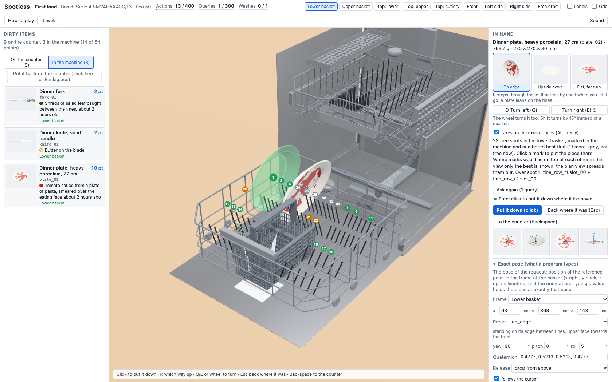
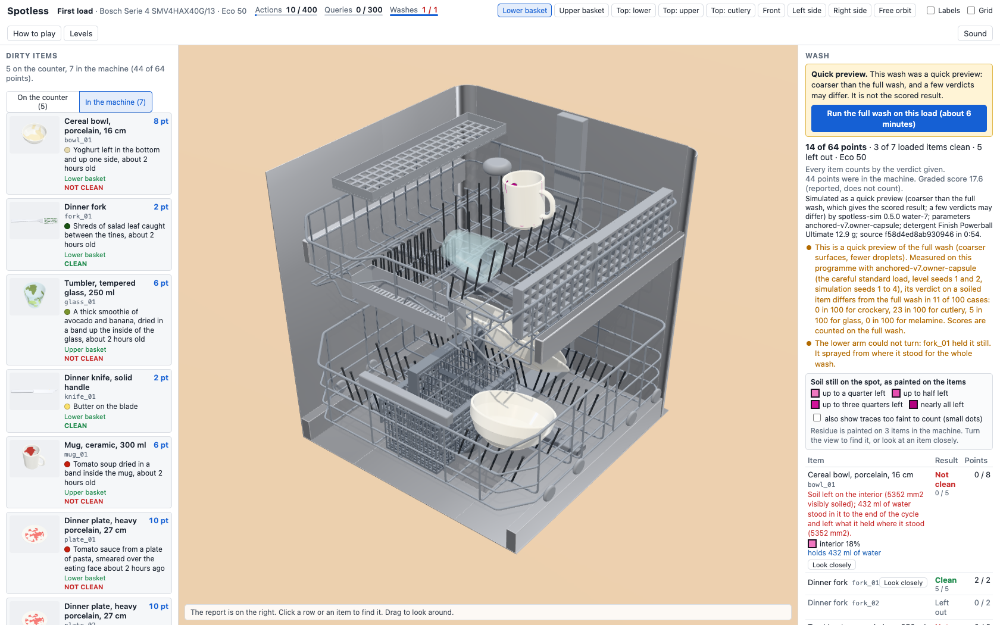
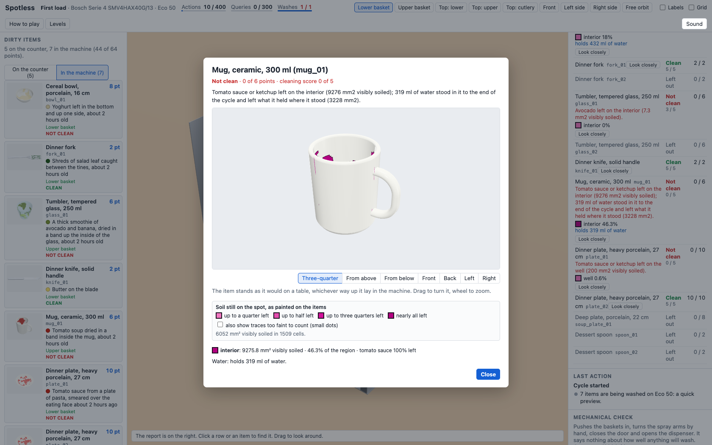
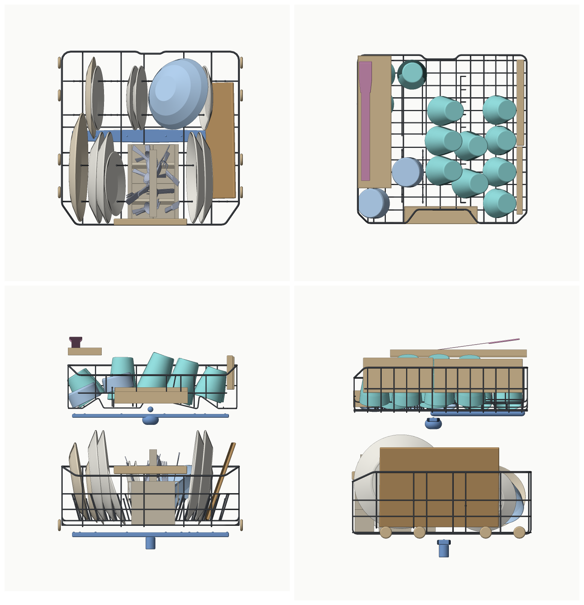

# DishwasherBench

[](LICENSE)
[](https://github.com/composo-ai/DishwasherBench/actions/workflows/ci.yml)

DishwasherBench is a dishwasher-loading game on a physical simulation of a real machine, built
to benchmark language models and playable by people in a browser. The game inside is called
**Spotless**, and the packages are named `@spotless/*`.

A player loads a 3D model of a Bosch SMV4HAX40G with rigid-body physics. A wash on its Eco 50
programme is then simulated (jets, droplets, run-off, soil and detergent chemistry), and the
player gets points for every item that comes out clean. On every level after the first, not
everything fits, so the player has to choose what to load and how.

- **Physical.** Loading is rigid-body physics on exact shapes. The wash traces water from the
  nozzle positions measured on the machine and is calibrated on a test wash of it.
- **Deterministic and verifiable.** The same load always settles the same way, and every
  episode is a record that anyone can verify by replaying it and by washing its load again.
- **One game for people and models.** People play in a browser and models play through MCP,
  with the same actions on the same grid.

Built and maintained by [Composo](https://composo.ai).



_Loading the first level in the browser. A dinner plate is in hand over the lower basket, and
"Suggest spots" has numbered the free seats, best first. The panel on the right holds the exact
pose a program would send._

## Contents

- [Features](#features)
- [Requirements](#requirements)
- [Quick start](#quick-start)
- [Play in the browser](#play-in-the-browser)
- [Run a scripted player](#run-a-scripted-player)
- [Run a model](#run-a-model)
- [Results](#results)
- [How it works](#how-it-works)
- [Scope and limitations](#scope-and-limitations)
- [Where things are](#where-things-are)
- [Contributing](#contributing)
- [Licence, notices and disclaimer](#licence-notices-and-disclaimer)
- [How to cite](#how-to-cite)

## Features

- **The machine.** A Bosch SMV4HAX40G as data and geometry, from photographs and tape readings
  of the real machine (`packages/machine`): both baskets with their tine rows, shelves and
  rests, the spray arms and the Eco 50 programme.
- **Loading.** A catalogue of items and soils, deterministic rigid-body loading (Jolt), and a
  session layer with the actions and queries of the game (`place`, `remove`, `set_rack`,
  `list_slots`, `check_load` and the rest).
- **The wash.** A simulation at two tiers: the **official** tier gives the scored result, and
  the **fast** tier a preview in about a minute. An official wash of the largest level takes
  about five minutes on a MacBook Pro (Apple M3 Pro).
- **A course of seven levels**, numbered in order of difficulty
  ([docs/benchmark/levels.md](docs/benchmark/levels.md)), each with saved reference loads of
  three scripted players (careful, careless, random).
- **Three ways to play.** The page (`apps/web`), an MCP server for agents (`packages/mcp`), and a
  harness that runs scripted players and models and writes verified episode records
  (`packages/bench`).
- **Checks.** 48 loading phenomena from the literature as executable pairs of washes
  ([docs/research/standards.md](docs/research/standards.md) section 9), and a calibration tool
  that scores the simulation against a record of a real wash, fits parameters and ranks candidate
  test washes.

## Requirements

- **macOS.** Developed and tested on a MacBook Pro (Apple M3 Pro, 18 GB) under macOS 27, where
  every figure in this repository was measured. Linux and Windows are untested
  ([issue 28](https://github.com/composo-ai/DishwasherBench/issues/28)).
- **Node 20.19 or newer** in the 20 line (`.nvmrc` pins 20.19.0; an older Node is refused at
  install), and **pnpm 9** (`package.json` names 9.4.0; `corepack enable` picks it up).
- **A GPU that Dawn can open.** The wash traces water on the GPU through WebGPU from Node (the
  `webgpu` package, version 0.6.2, which carries prebuilt Dawn binaries). On a Mac that is
  Metal. Version 0.6.2 loads on macOS 27 and does not load on macOS 14.7.
- **Google Chrome or Chromium**, for the pictures an agent is sent and for the scripts that
  drive the page. The harness looks for it in the usual install locations; set
  `SPOTLESS_CHROME` to the path of the program to choose another. Playing by hand needs only a
  desktop browser, and scripted players need none (`--no-render`).
- **Disk and memory.** About 680 MB for the clone (a download of about 290 MB) and about
  420 MB for `node_modules`; 1 to 2 GB of memory for an official wash of a level.
- **Ports** 8787 (game server) and 8788 (MCP server), or others of your choosing.

Results are repeatable bit for bit on one machine, and every result names the stack it was
computed on: across machines, operating-system builds and versions of the `webgpu` package,
results can differ in the last bits
([docs/research/spike-gpu-compute-macos27-recheck.md](docs/research/spike-gpu-compute-macos27-recheck.md)).

## Quick start

```sh
git clone https://github.com/composo-ai/DishwasherBench.git
cd DishwasherBench
corepack enable                       # once: makes pnpm 9.4.0 available
pnpm install --frozen-lockfile        # about 15 seconds the first time
```

There is no build step for the packages: they are consumed as TypeScript source and run with
`tsx`. Only the page is built, by the `play` command below.

Wash a saved load from the command line:

```sh
pnpm --filter @spotless/wash-runner wash-load tutorial-careful --tier fast       # under a minute
pnpm --filter @spotless/wash-runner wash-load tutorial-careful --tier official   # about 5 minutes the first time
```

It prints the points and, for each item, the verdict, the score and what is left on it. The
saved loads are in `packages/loader/loads/` (`<level>-<player>.json`). The first wash of a load
works out where the water goes and keeps that in `.spotless/exposure-cache`, so a second wash
of the same load takes seconds to about a minute (pass `--no-cache` to switch this off).

Run the checks:

```sh
pnpm typecheck      # the root and every package; a few seconds
pnpm test           # every package; 8 to 17 minutes, with real washes on the GPU
```

**A wash is tied to its parameter set.** The set the game washes with
(`anchored-v7.owner-capsule`, in `packages/calibration/anchors/`) records the state of the
simulation source and of the machine data it was made for. After a change to either, the wash
stops and lists what differs. [CONTRIBUTING.md](CONTRIBUTING.md) explains the rule and how to
make the set current again.

## Play in the browser

```sh
pnpm --filter @spotless/web play
```

This builds the page and starts the game server. Open http://127.0.0.1:8787 (add `--port <n>`
for another port). **The page plays music**; the Sound button turns it off.

When you start the wash you choose between two kinds:

- **Quick preview**: the fast tier, in about a minute.
- **Full wash**: the official tier, in several minutes. This is the scored result, and the
  report of a preview offers it on the same load.

The game is scored on Eco 50 with one capsule of detergent (Finish Powerball Ultimate, 12.9 g).
The levels are listed 1 to 7 in order of difficulty.

Plates, bowls and cutlery are placed by pointing. For a tight spot, such as a plate beside one
already placed or a cup against the side rests of the upper basket, pick the piece up and press
"Suggest spots" (it costs one query), then click a numbered mark.

The server answers the page it serves and clients on your own machine. `--allow-origin` admits
a page served from another origin, and `--allow-host` a request under another host name
([SECURITY.md](SECURITY.md)).



_After a quick preview of a deliberately careless load of the first level: a bowl left mouth up
holds 432 ml of water and is not clean, and the report says that a fork held the lower spray
arm still._



_Looking closely at one item after the wash: the residue is painted where it was left, with its
area and the water the item held._

## Run a scripted player

A scripted player needs no model and costs nothing. This plays the first level with the careful
reference player at the official tier, then verifies the record by replaying its actions and by
washing the load a second time (about five minutes each):

```sh
pnpm --filter @spotless/bench bench run --levels tutorial --policies careful \
  --no-render --out "$PWD/.spotless/bench/scripted"
pnpm --filter @spotless/bench bench verify \
  "$PWD"/.spotless/bench/scripted/tutorial__careful__*/record.json --rewash
```

- Give `--out` as an absolute path; a relative one resolves inside `packages/bench`.
- The scripted players are `empty`, `random`, `careless` and `careful`. Add `--tier fast` for a
  preview in about a minute; the record and the results table label it as a preview.
- Each run writes under `--out`: `record.json`, a results table (`results.md`, `results.json`),
  the data of the game server it started (`server-data/`) and, without `--no-render`, the
  pictures the tools returned.



_The scripted careful player's load of the largest level (62 pieces on the counter, 49 loaded),
from above and from the front and side. Both models that have played beat it._

## Run a model

Everything about the harness, what each kind of player sees and what is recorded is in
[docs/benchmark/README.md](docs/benchmark/README.md).

**A model run costs money.** Copy `.env.example` to `.env` (which git ignores) and fill in the
address and the key of your endpoint. The command prints the names of the variables it set,
never a value, and neither the key nor the address is written to a record.

A model behind an OpenAI-compatible endpoint (OpenAI, Azure, or any server with the Responses
or chat completions API):

```sh
pnpm --filter @spotless/bench bench run --levels tutorial --policies openai:gpt-6.1-sol \
  --max-input-tokens 2000000 --out "$PWD/.spotless/bench/sol-tutorial"
```

- The policy names the model or, on Azure, the deployment: `openai:<model or deployment>`.
- `--max-input-tokens` ends an episode before its requests add up to more. The first level
  takes 0.4 to 0.65 million input tokens, a level of 37 pieces 2.5 to 2.8 million, and the
  largest level (62 pieces) 3.0 to 3.2 million, with 95 % or more of it read from the
  provider's cache. Use limits of 2,000,000, 12,000,000 and 20,000,000.
- The harness records tokens, and a cost when prices are given in `.env`.
- The wash is at the official tier, which is the score; `--tier fast` gives a preview.
- Each run writes the record, the transcript, the pictures and a results table under `--out`,
  and verifies the episode by replaying its action log.
- With no address set, no request is made and the command exits with status 1.

A model through Anthropic's API, with the key in `ANTHROPIC_API_KEY` (put the model's id in
place of `<model id>`):

```sh
pnpm --filter @spotless/bench bench run --levels tutorial --policies anthropic:<model id> \
  --max-input-tokens 2000000 --out "$PWD/.spotless/bench/anthropic-tutorial"
```

The SDK also accepts a stored login profile, so a run can spend without a key in `.env`.

### Connect an MCP client

Any agent that speaks MCP can play. An MCP server is bound to one episode, so start the game
server in benchmark mode and create the episode first.

```sh
# 1. The game server (the token: 8 characters or more, of your choosing)
pnpm --filter @spotless/server exec tsx src/cli.ts serve --admin-token <token> --wash-tier fast \
  --data "$PWD/.spotless"

# 2. An episode; prints an address for the page, and the episode's id
pnpm --filter @spotless/server exec tsx src/cli.ts link --admin-token <token> \
  --level tutorial --player my-agent --agent

# 3. For a client that speaks streamable HTTP: serves http://127.0.0.1:8788/mcp
pnpm --filter @spotless/mcp exec tsx src/cli.ts --server http://127.0.0.1:8787 \
  --session <episode id> --http --port 8788
```

`--data` keeps the server's files, the episode records among them (`.spotless/episodes/`), in
the directory the page uses; without it `serve` writes to `packages/server/.spotless`. The
address that `link` prints shows the episode in the page once the page has been built
(`pnpm --filter @spotless/web build`, which `play` also does). If the game server is on another
port (`serve --port <n>`), give `link` its address with `--server http://127.0.0.1:<n>`. For a
desktop client that starts the MCP server itself over stdio, the configuration is in
[docs/benchmark/README.md](docs/benchmark/README.md) section 3.

The agent gets thirteen tools (`place`, `remove`, `reset`, `set_rack`, `start_cycle`,
`get_level`, `get_item`, `get_state`, `render`, `preview`, `list_slots`, `check_load`,
`get_report`). To try one call by hand:

```sh
pnpm --filter @spotless/mcp exec tsx scripts/call.ts --url http://127.0.0.1:8788/mcp get_state '{}'
```

Both servers listen on 127.0.0.1 and serve clients on your own machine. For a client that
reaches them under another name, for example from a container, start them with
`--allow-host <name>` ([SECURITY.md](SECURITY.md)).

## Results

Two models have played three levels of the course at the official tier, through one
OpenAI-compatible endpoint: six episodes, and each figure is a single episode. Points, with the
share of the level's points. The middle columns are the scripted reference players.

| #   | Level                | Points on offer | Random      | Careless     | Careful      | `gpt-6.1-sol`                               | `gpt-6-astra` |
| --- | -------------------- | --------------- | ----------- | ------------ | ------------ | ------------------------------------------- | ------------- |
| 1   | tutorial (12 pieces) | 64              | 20 (31.3 %) | 58 (90.6 %)  | 64 (100 %)   | 64 (100 %)                                  | not run       |
| 4   | breakfast (37)       | 220             | 36 (16.4 %) | 112 (50.9 %) | 174 (79.1 %) | 190 (86.4 %); a second episode 188 (85.5 %) | 175 (79.5 %)  |
| 7   | dinner-party (62)    | 367             | 88 (24.0 %) | 100 (27.2 %) | 250 (68.1 %) | 260 (70.8 %)                                | 274 (74.7 %)  |

`gpt-6.1-sol` and `gpt-6-astra` are the names of the two deployments on the Azure endpoint
used; both ran at medium reasoning effort. The three scripted columns are the saved reference
loads ([docs/benchmark/course-table.md](docs/benchmark/course-table.md)).

- **Both models beat the careful reference load** on both full levels, by placing pans, a
  platter and boards that the scripted player never tries.
- **Neither model made the mistake the levels are built around.** No hollow piece was stood
  mouth up or laid on its side in six episodes, and what the models loaded came out 84 to 100 %
  clean. Their scores differ by what they fitted in.

The records, transcripts and pictures of the six episodes, and a fuller account, are in
[docs/benchmark/first-runs/course/](docs/benchmark/first-runs/course/README.md). Each episode
verifies by replay and by a second wash with the same verdicts and points.
[Scope and limitations](#scope-and-limitations) says what decides a score.

## How it works

**Loading.** Every item and every part of the machine is a rigid compound of exact shapes
generated from a parametric description; the picture, the collision shape and the surfaces the
wash sees all come from that one description. Items are placed with rigid-body physics (Jolt)
at a fixed step, with the player's inputs rounded to 1 mm and 1 degree, so that a person and a
model act on the same grid and the same load always settles the same way. Every action is
logged with a hash of the scene after it, and replaying the log must reproduce every hash.
See [docs/design/platform.md](docs/design/platform.md).

**The wash.** Jets are traced on the GPU from the nozzle positions measured on the machine and
the turning of the arms, onto the exact shapes of the load. Splash and drips travel as
droplets; water that lands runs down surfaces as a film, pools where a surface holds it and
drains where it does not. A soil model per kind of soil then removes soil with time,
temperature and the chemistry of the wash water (detergent, enzymes, bleach), over the whole
programme. Where the water goes is cached apart from the soil and the chemistry, so a wash with
other soil parameters replays in seconds to about a minute. The official tier works on blocks
of 2 mm, the fast tier on 4 mm. See [docs/design/scope.md](docs/design/scope.md) for what is
built and what is left out, and [docs/design/sim-core.md](docs/design/sim-core.md) for the
design of the physics.

**The scoring.** After the wash an inspector looks at every item. An item is clean when it
carries at most 4 specks and 4 mm² of visible soil, counting what dirty water left where it
stood on the item. Each item is worth a number of points stated on the level card; a clean item
earns them, an item that is not clean or was left on the counter earns nothing. An episode is
one load and one wash. The report also gives a graded score from 0 to 5 for each item and what
is left where, which do not change the points. See
[docs/benchmark/README.md](docs/benchmark/README.md) and
[docs/benchmark/levels.md](docs/benchmark/levels.md).

**The calibration.** Every physical constant of the wash is in a parameter registry with a
default, a range and a source. A _wash record_ describes a real test wash: the machine and the
programme, each item with its soil and where it stood, and what was seen afterwards. The
calibration tool runs the simulation on a record, scores it against what was seen, fits chosen
parameters and says which parameters the data can and cannot identify. The first wash record is
four egg-yolk plates on Eco 50. See
[docs/calibration/wash-record.md](docs/calibration/wash-record.md),
[docs/calibration/fitting.md](docs/calibration/fitting.md) and, for the set the game washes
with, [docs/calibration/anchoring-v7.md](docs/calibration/anchoring-v7.md).

### Check the simulation yourself

The phenomena suite (48 phenomena, 82 washes; about 15 minutes at the fast tier when nothing is
cached, two and a half when everything is). Run these from the root of the repository, in a
POSIX shell:

```sh
INIT_CWD=. pnpm exec tsx packages/sim-verify/src/phenomena/cli.ts --list
INIT_CWD=. pnpm exec tsx packages/sim-verify/src/phenomena/cli.ts P01 P36 --tier fast \
  --out .spotless/phenomena
INIT_CWD=. pnpm exec tsx packages/sim-verify/src/phenomena/cli.ts P36 --tier fast \
  --params packages/calibration/anchors/anchored-v7.owner-capsule.json --dose-g 12.9 \
  --out .spotless/phenomena
```

With no ids it runs all 48. Without `--params` it washes with the registry defaults and the
reference detergent; the third form washes as the game does, with the calibrated set and the
capsule. The commands above send their reports to the git-ignored `.spotless/phenomena`. The
default is `packages/sim-verify/phenomena/reports/`, which holds the stored reports of the
project.

The calibration tool, on the first test wash:

```sh
pnpm --filter @spotless/calibration spotless-fit validate \
  packages/calibration/records/owner/owner-wash-01-egg-yolk-eco50.measured.json
pnpm --filter @spotless/calibration spotless-fit predict \
  packages/calibration/records/owner/owner-wash-01-egg-yolk-eco50.measured.json \
  --params packages/calibration/anchors/anchored-v7.owner-capsule.json
```

`validate` checks a wash record; `predict` says what the simulation gives for every observation
in it (five to seven minutes the first time, less once the water of the load is cached). With
`--params`, `predict` washes as the game does; without it, it uses the registry defaults. Its
warning that there is no `calibration.json` beside the set is expected.

The saved loads against the loading physics:

```sh
pnpm --filter @spotless/loader check-loads tutorial-careful
pnpm --filter @spotless/loader check-loads --jobs 3      # all 25 of them: about 50 minutes
```

## Scope and limitations

DishwasherBench models one machine and scores one programme, Eco 50, with one detergent. The
wash is calibrated on a test wash of that machine (four egg-yolk plates) and on the published
class means of a sister machine, the Bosch SMV6ECX51E.
[docs/validation/README.md](docs/validation/README.md) has the full account, with every number
and where it comes from.

Three things decide most of a score:

- **What is loaded.** An item left on the counter earns nothing.
- **Which way up the hollow pieces go.** A glass, mug or pot left mouth up comes out not clean.
  About three quarters of the gap between a careful and a careless reference load is hollow
  pieces put in the wrong way up.
- **Detergent and nesting.** A blocked detergent tray leaves protein soils (egg, yoghurt,
  mince, milk) on the load, and a bowl or spoon that lies fully in another comes out not clean.

The wash does not respond to how plates and cutlery are stacked: plates that lean on each other
and cutlery crowded into one cell come out clean, where a real machine would be expected to
leave soil. A score therefore does not show how well plates and cutlery were stacked
([issue 1](https://github.com/composo-ai/DishwasherBench/issues/1)). Of the 48 loading
phenomena in the suite, 17 pass. Drying, spots and film on glass, items moved by the jets and
soil settling on clean pieces are outside the model
([issue 7](https://github.com/composo-ai/DishwasherBench/issues/7)). The adapter for
Anthropic's API is tested against a local stand-in only
([issue 13](https://github.com/composo-ai/DishwasherBench/issues/13)).

Open work is tracked as [issues](https://github.com/composo-ai/DishwasherBench/issues), each
written as something a contributor could pick up, and [docs/ROADMAP.md](docs/ROADMAP.md) is the
map of them.

## Where things are

| Path                                                   | What                                                                                                                      |
| ------------------------------------------------------ | ------------------------------------------------------------------------------------------------------------------------- |
| [docs/README.md](docs/README.md)                       | The index of the documents, with a reading order and a label for each: current, record of the build, or superseded        |
| [docs/design/scope.md](docs/design/scope.md)           | The aim of the project, what was built first, what is left out, the status                                                |
| [docs/validation/README.md](docs/validation/README.md) | What the simulation was checked against and what a verdict can be trusted for                                             |
| [docs/benchmark/](docs/benchmark/README.md)            | Running the benchmark, the course of levels, the first runs with models                                                   |
| [docs/calibration/](docs/calibration/protocol.md)      | The protocol of test washes for calibrating the simulation, the wash-record format, the fitting tool, the first test wash |
| `docs/research/`                                       | Sourced dossiers: the machine, jets, films, soils, chemistry, standards, the benchmark's design                           |
| [docs/reference/](docs/reference/REDACTIONS.md)        | Photographs and measurements of the machine, the machine drawings, the photographs of the test wash                       |
| `packages/machine`, `catalogue`, `geometry`, `physics` | The machine, the items and soils, shapes, loading physics                                                                 |
| `packages/session`, `levels`, `loader`                 | The game's actions and queries, the levels, the scripted players and their saved loads                                    |
| `packages/sim-*`, `inspector`                          | The wash: scene, hydraulics, jets, spray, film, liquor, soil, timeline, the inspection of the result                      |
| `packages/wash-runner`                                 | The wash as the game runs it: default parameters, reports                                                                 |
| `packages/calibration`                                 | Wash records, the fitting tool, the parameter sets (`anchors/`)                                                           |
| `packages/sim-verify`                                  | The phenomena suite and demonstration washes                                                                              |
| `packages/server`, `mcp`, `bench`, `render`            | Game server, agent interface, benchmark harness, pictures                                                                 |
| `apps/web`                                             | The page                                                                                                                  |
| `scripts/`                                             | The hygiene check that guards what is published, and its tests                                                            |
| `spikes/`                                              | The exploratory code of two early trials (GPU compute, rigid-body engines)                                                |

## Contributing

Bug reports, results that look physically wrong, test washes of a real machine, new levels,
model results with their episode records and reports from other platforms are all welcome.
[CONTRIBUTING.md](CONTRIBUTING.md) says how to set up, which checks to run before a pull
request, and the rule for changing the simulation's source, which is fingerprinted. Please read
the [code of conduct](CODE_OF_CONDUCT.md).

Questions go to the question form among the
[issue forms](https://github.com/composo-ai/DishwasherBench/issues/new/choose). Anything
private goes to support@composo.ai; to report a security problem, or something in a photograph
or a record that should not be public, see [SECURITY.md](SECURITY.md). What each version
contains is in [CHANGELOG.md](CHANGELOG.md).

## Licence, notices and disclaimer

DishwasherBench is released under the [MIT licence](LICENSE), copyright Composo Limited.
Material from others, and the main software the project depends on, is listed in
[THIRD_PARTY_NOTICES.md](THIRD_PARTY_NOTICES.md): the music in the game is in the public domain
(CC0), and the short passages that the research notes quote remain their authors'. The
photographs of the machine are published with its owner's permission under the same MIT
licence, and were prepared for publication as
[docs/reference/REDACTIONS.md](docs/reference/REDACTIONS.md) describes.

DishwasherBench is an independent project of Composo Limited and is not affiliated with,
sponsored by or endorsed by BSH Hausgeräte GmbH or Robert Bosch GmbH (Bosch), Reckitt (Finish)
or any other manufacturer named in it. All product names and trademarks belong to their
respective owners and are used only to identify what was measured. The simulation is a
simplified model of one privately owned machine, built from its owner's photographs,
measurements and test wash together with public documents, and many of its parameters are
estimates. Nothing in the game, the benchmark results or the documents is a statement about the
performance, quality or safety of any real product, and the loading advice shown in the game is
the project's own summary of the manufacturer's manual, not the manufacturer's instructions.

## How to cite

[CITATION.cff](CITATION.cff) has the details in a form GitHub and reference managers read. In
BibTeX:

```bibtex
@software{dishwasherbench,
  author = {{Composo}},
  title  = {DishwasherBench},
  version = {0.1.0},
  year   = {2026},
  url    = {https://github.com/composo-ai/DishwasherBench}
}
```
